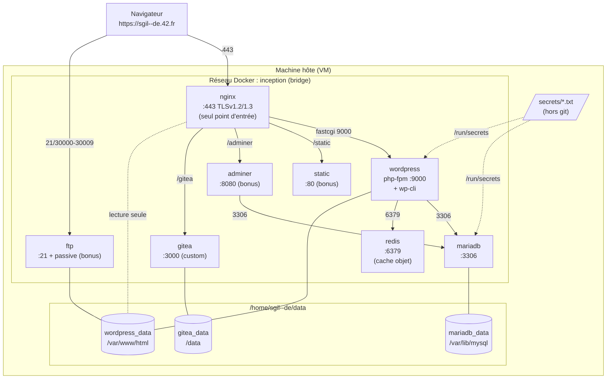
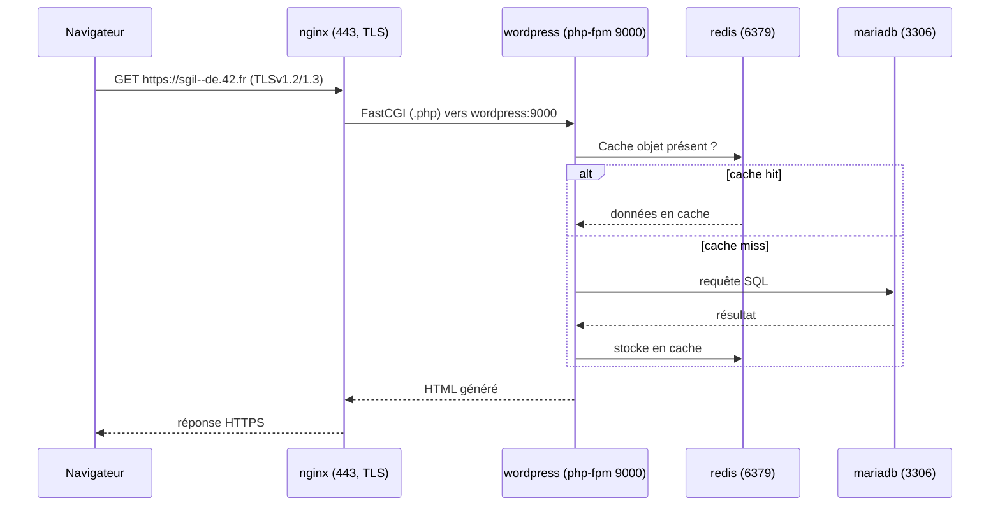
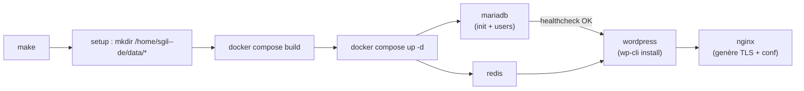
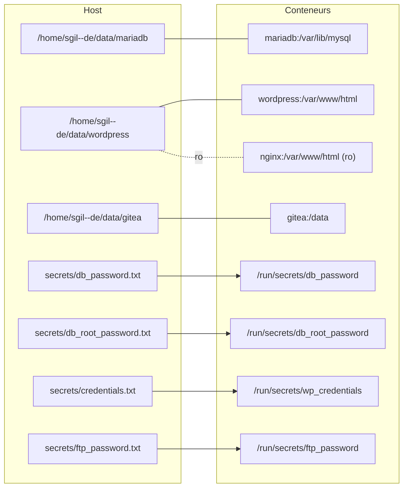
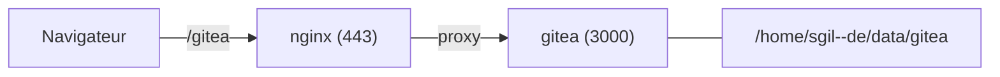

# Rapport Inception — tout ce qu'il faut savoir pour défendre le projet

Ce document explique l'architecture, chaque choix technique, et comment
**t'approprier le projet** pour la soutenance. Le service custom est **Gitea**
(forge Git légère), construit depuis ta propre image Debian.

---

## 1. Vue d'ensemble de l'infrastructure



**Idée clé** : pour le web, seul `nginx` est exposé (port 443). Le bonus FTP
ouvre aussi les ports 21 + 30000-30009. Tout le reste communique sur le réseau
Docker interne `inception`.

---

## 2. Flux d'une requête (du navigateur à la base)



---

## 3. Cycle de vie / dépendances au démarrage



`wordpress` attend que `mariadb` soit **healthy** (`condition: service_healthy`)
et que `redis` soit démarré avant de lancer l'installation WordPress.

---

## 4. Détail de chaque service

| Service | Image (= nom service) | Base | Process PID 1 | Rôle |
|--------|----------------------|------|---------------|------|
| mariadb | `mariadb` | debian:12-slim | `mysqld --user=mysql` | Base de données |
| wordpress | `wordpress` | debian:12-slim | `php-fpm8.2 -F` | WordPress + PHP |
| nginx | `nginx` | debian:12-slim | `nginx -g 'daemon off;'` | Reverse proxy TLS |
| redis | `redis` | debian:12-slim | `redis-server` | Cache objet (bonus) |
| adminer | `adminer` | debian:12-slim | `php -S` | GUI base (bonus) |
| static | `static` | debian:12-slim | `nginx -g 'daemon off;'` | Site statique (bonus) |
| ftp | `ftp` | debian:12-slim | `vsftpd` | FTP vers volume WordPress (bonus) |
| gitea | `gitea` | debian:12-slim | `gitea web` | Forge Git (custom) |

### mariadb
- Init **sans serveur temporaire ni `sleep`** : utilise `mysql_install_db`
  puis `mysqld --bootstrap` (lit du SQL puis se termine). Pas de boucle infinie.
- Crée la base, l'utilisateur applicatif et fixe le mot de passe root depuis
  les **secrets Docker** (`/run/secrets/...`).
- Tourne en root juste le temps de s'approprier le volume bind, puis
  `mysqld` **abandonne ses privilèges** vers l'utilisateur `mysql`.

### wordpress
- Installé/configuré **automatiquement** via `wp-cli` au premier démarrage :
  `wp core download` → `wp config create` → `wp core install`.
- **Deux utilisateurs** créés (exigence du sujet) :
  - admin : `WP_ADMIN_USER` (= `sgil-de`, **ne contient pas** `admin`).
  - second : `WP_USER` (rôle `author`).
- Branche **Redis** : constantes `WP_REDIS_HOST/PORT` dans `wp-config.php`,
  plugin `redis-cache` activé + `wp redis enable` (drop-in `object-cache.php`).
- Pas de nginx dans ce conteneur (php-fpm seul, écoute TCP 9000).

### nginx
- **Seul** point d'entrée web (port 443), `TLSv1.2`/`TLSv1.3`.
- Certificat auto-signé généré au démarrage (`setup_ssl.sh`).
- Le domaine est injecté dans la conf via `envsubst` (`${DOMAIN_NAME}`),
  donc 0 valeur en dur, tout vient du `.env`.
- `entrypoint.sh` finit par `exec nginx -g 'daemon off;'` → nginx est PID 1.

### redis (bonus)
Cache objet WordPress (voir section 7 pour le service custom Gitea).

### adminer (bonus)
Image **construite par nous** (Debian + php-cli + adminer.php servi par le
serveur web intégré de PHP). Accessible sur `https://sgil--de.42.fr/adminer/`.

### static (bonus)
Site vitrine simple (HTML/CSS) servi par un nginx dédié. Exposé via
`https://sgil--de.42.fr/static/` (reverse proxy nginx principal).

### ftp (bonus)
Serveur `vsftpd` pointant sur le volume WordPress (`/var/www/html`). L’utilisateur
FTP a le même UID/GID que `www-data` pour éviter les soucis de droits.
Ports exposés : `21` + plage passive `30000-30009`.

### gitea (service custom)
Forge Git auto‑hébergée, utile pour centraliser les dépôts pendant la démo. La
configuration est stockée dans `/home/sgil--de/data/gitea`.

---

## 5. Volumes & secrets



- **Volumes nommés bind-backed** : déclarés comme volumes Docker nommés
  (`driver: local`, `driver_opts type=none,o=bind`) mais leurs données
  vivent dans `/home/sgil--de/data`. C'est la solution attendue par le sujet
  (volume nommé **ET** données dans `/home/login/data`).
- **Secrets** : fichiers texte hors git, montés en lecture seule dans
  `/run/secrets/`. Aucun mot de passe dans les Dockerfiles ni dans git.
- `credentials.txt` contient les mots de passe WordPress au format
  `WP_ADMIN_PASSWORD=...` / `WP_USER_PASSWORD=...`.

---

## 6. Notions à maîtriser pour la soutenance

### Machine virtuelle vs Docker
Une VM virtualise un **OS complet** (noyau inclus) via un hyperviseur :
lourd, lent à démarrer, isolation forte. Un conteneur Docker partage le
**noyau de l'hôte** et n'isole que les processus/fs/réseau : léger,
démarrage en secondes. Ici un conteneur ≠ une VM → pas de `tail -f`,
pas de boucle infinie, **un seul processus principal en PID 1**.

### Secrets vs variables d'environnement
Les variables d'env (`.env`) sont pratiques mais **visibles** (`docker
inspect`, logs, `/proc`). Les **secrets** sont des fichiers montés en
lecture seule, hors image et hors git → on y met **uniquement les mots de
passe**. Le `.env` ne contient que des valeurs non sensibles (domaine,
noms de base, logins).

### Réseau Docker vs réseau Host
`network: host` supprimerait l'isolation réseau (le conteneur utilise la
pile réseau de l'hôte) → **interdit** par le sujet. On crée un **réseau
bridge dédié** (`inception`) : les conteneurs se joignent par leur **nom de
service** (DNS interne Docker). Pour le web, seul le port 443 de nginx est
publié ; le bonus FTP expose aussi 21 + 30000-30009.

### Volumes Docker vs bind mounts
Un **bind mount** monte un chemin hôte arbitraire (fragile, dépend du
chemin). Un **volume nommé** est géré par Docker (cycle de vie clair). Le
sujet impose des volumes nommés *mais* avec les données dans
`/home/login/data` → on combine les deux via `driver_opts` (volume nommé
adossé à un bind contrôlé). Bind mount « brut » interdit pour ces 2 volumes.

---

## 7. Service custom : Gitea (forge Git auto‑hébergée)

**Pourquoi Gitea ?** C’est une forge Git légère (comparée à GitLab), parfaite
pour démontrer un service utile en soutenance : création de dépôts, issues,
pull requests, tout en restant simple et autonome.

**Comment c'est branché :**



1. Image **construite** depuis `debian:12-slim` :
  [srcs/requirements/gitea/Dockerfile](srcs/requirements/gitea/Dockerfile).
2. Données persistées dans un volume nommé bind-backed (`/home/sgil--de/data/gitea`).
3. Accès via `https://sgil--de.42.fr/gitea/` grâce au reverse proxy nginx.

---

## 8. Utilisation

```bash
make            # crée les dossiers data, build, démarre (détaché)
make logs       # suivre les logs
make ps         # état des conteneurs
make down       # arrêter (garde les données)
make clean      # arrêter + supprimer les volumes
make fclean     # tout nettoyer (images + data hôte)
make re         # fclean puis relance
```

**Prérequis domaine** (sinon le navigateur n'atteint pas le site) :
ajouter dans `/etc/hosts` de la VM :
```
127.0.0.1   sgil--de.42.fr
```

Accès :
- Site : `https://sgil--de.42.fr` (certificat auto-signé → accepter l'alerte)
- Admin WP : `https://sgil--de.42.fr/wp-admin` (user `sgil-de`)
- Statique : `https://sgil--de.42.fr/static/`
- Adminer : `https://sgil--de.42.fr/adminer/` (serveur : `mariadb`)
- Gitea : `https://sgil--de.42.fr/gitea/`
- FTP : `ftp://<ip_hote>` (user = `FTP_USER`, port 21 + 30000-30009)

---

## 9. Ce qui a été corrigé (avant → après)

| Problème | Avant | Après |
|---------|-------|-------|
| WordPress non installé | simple `wget` du core | wp-cli : install + 2 users + redis |
| Volumes hors `/home` | volumes nus | `driver_opts` → `/home/sgil--de/data` |
| Secrets vides + commités | fichiers 0 octet, suivis git | remplis + `git rm --cached` |
| Domaine absent | `server_name localhost` | `${DOMAIN_NAME}` via envsubst + `.env` |
| Noms d'images | `inception_xxx:1.0.0` | `mariadb`, `wordpress`, `nginx`... |
| `.env` à la racine | `../.env` | `srcs/.env` (arbo conforme) |
| Healthcheck nginx | `curl -f` (échoue) | `curl -fk` |
| PID 1 nginx | `sh -c "... && nginx"` | `exec nginx` via entrypoint |
| redis/adminer/gitea/static/ftp | images DockerHub | Dockerfiles maison |
| MariaDB init | serveur temp + `sleep` | `mysqld --bootstrap` (propre) |

---

## 10. Questions probables en défense (et réponses)

- **« Pourquoi pas une image WordPress toute faite ? »** — Le sujet
  l'interdit ; on construit nos images depuis Debian 12 (avant-dernière
  stable).
- **« Pourquoi `mysqld --bootstrap` et pas un `sleep` ? »** — Un conteneur
  n'est pas une VM ; pas de hack/boucle. `--bootstrap` exécute le SQL
  d'init puis rend la main, et le process final `mysqld` est PID 1.
- **« Où sont les mots de passe ? »** — Dans `secrets/*.txt`, hors git,
  montés dans `/run/secrets`. Rien en dur, rien dans `.env`.
- **« Pourquoi deux réseaux... non, un réseau ? »** — Un seul réseau bridge
  `inception` suffit, isolation interne, résolution DNS par nom de service,
  443 publié pour le web (+ ports FTP pour le bonus).
- **« Le volume est-il un bind mount ? »** — Non, c'est un **volume nommé**
  Docker ; `driver_opts` le fait simplement pointer vers
  `/home/sgil--de/data` comme l'exige le sujet.
- **« Domaine ? »** — `sgil--de.42.fr` → `127.0.0.1` via `/etc/hosts`,
  injecté dans la conf nginx par `envsubst`.
