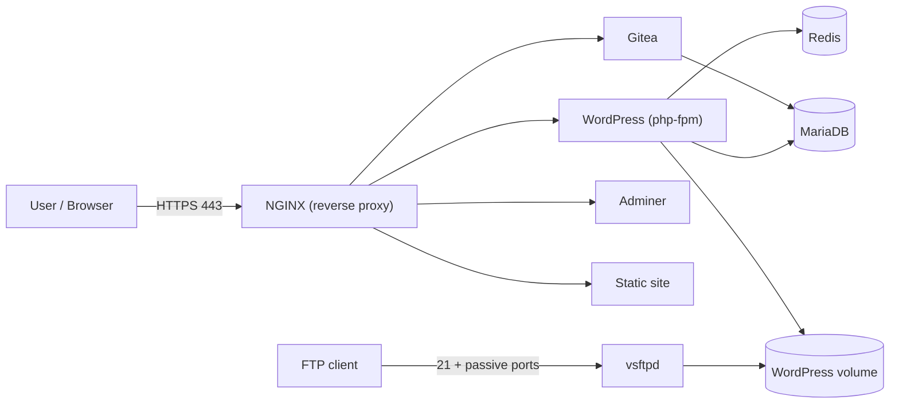

*This project has been created as part of the 42 curriculum by sgil--de.*

# Inception

## Description

Inception is a system administration project: a complete web infrastructure made of **8 containers**, each
built from scratch on the penultimate stable Debian (no ready-made images), orchestrated with Docker Compose and a
Makefile. NGINX is the only web entrypoint, on port 443 with TLSv1.2/TLSv1.3 only.

| Service | Role | Part |
| --- | --- | --- |
| **NGINX** | TLS reverse proxy, single HTTPS entrypoint | Mandatory |
| **WordPress + php-fpm** | Website, installed and configured automatically with WP-CLI | Mandatory |
| **MariaDB** | Database, bootstrapped on first start, with a healthcheck | Mandatory |
| **Redis** | Object cache for WordPress | Bonus |
| **FTP (vsftpd)** | Access to the WordPress files | Bonus |
| **Adminer** | Database web GUI (`/adminer/`) | Bonus |
| **Gitea** | Self-hosted Git forge (`/gitea/`) sharing MariaDB | Bonus |
| **Static site** | Simple static page (`/static/`) | Bonus |

Highlights: passwords handled as **Docker secrets** (never in the image or in git), healthchecks and
`depends_on` conditions for a correct startup order, persistent named volumes, and a local CA whose certificates
survive restarts.

## Architecture (Mermaid)



## Instructions

Prerequisites: Docker Engine + Docker Compose, run inside a Virtual Machine.

```bash
# 1. Copy and adapt the environment file
cp srcs/.env.example srcs/.env

# 2. Create the secrets and replace every PUT_MDP_HERE with a password
cp -r secrets_examples secrets

# 3. Map the domain to localhost (on the VM)
echo "127.0.0.1 sgil--de.42.fr" | sudo tee -a /etc/hosts

# 4. Build and start everything
make
```

Then open `https://sgil--de.42.fr`. Useful targets: `make logs`, `make ps`,
`make down`, `make clean`, `make fclean`, `make re`.
See `USER_DOC.md` (end users) and `DEV_DOC.md` (developers).

## Resources

- Docker docs — https://docs.docker.com/
- Docker Compose — https://docs.docker.com/compose/
- WP-CLI — https://wp-cli.org/
- NGINX + php-fpm (FastCGI) — https://nginx.org/en/docs/
- MariaDB Docker init — https://mariadb.com/kb/en/
- Redis object cache for WordPress — https://wordpress.org/plugins/redis-cache/

**Use of AI:** AI was used as an assistant to audit the project against the
subject, refactor the service Dockerfiles/entrypoints (WordPress wp-cli
automation, MariaDB bootstrap, NGINX envsubst), wire the Redis object cache,
and draft the documentation. Every generated change was reviewed, tested via
`docker compose config`, and is fully understood by the author.

## Project description

Docker is used to run each service in its **own container** from a
**self-built image** (Debian 12, the penultimate stable). The Makefile calls
`docker compose` which builds the Dockerfiles in `srcs/requirements/*`.
Persistent data lives in named volumes backed by `/home/sgil--de/data`.
Passwords are provided as Docker secrets; non-sensitive values via `.env`.
NGINX TLS assets are stored in a dedicated volume (`nginx_ssl`) so the local
CA and server certificate survive container restarts.

Main design choices and comparisons:

- **Virtual Machines vs Docker** — A VM virtualizes a full OS (own kernel)
  through a hypervisor: heavy, strong isolation, slow boot. A container
  shares the host kernel and isolates only processes/fs/network: lightweight,
  starts in seconds. Hence one process as PID 1, no `tail -f`/infinite loop.
- **Secrets vs Environment Variables** — Env vars are convenient but visible
  (`docker inspect`, logs). Secrets are read-only files mounted at
  `/run/secrets`, kept out of the image and git. Only passwords are secrets;
  the `.env` holds non-sensitive config.
- **Docker Network vs Host Network** — `network: host` removes network
  isolation and is forbidden. A dedicated bridge network (`inception`) lets
  containers reach each other by service name; the only published ports are
  443 (HTTPS) and the FTP bonus ports.
- **Docker Volumes vs Bind Mounts** — A raw bind mount is fragile and
  forbidden for the two required volumes. Named volumes are managed by
  Docker; here `driver_opts` makes them store data under
  `/home/sgil--de/data` as required.
