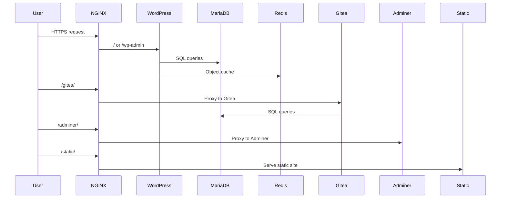

# User Documentation

## Services provided by the stack

| Service | Purpose | Access |
|---------|---------|--------|
| nginx | HTTPS entrypoint (TLS) | https://sgil--de.42.fr |
| wordpress | The website + admin panel | https://sgil--de.42.fr/wp-admin |
| mariadb | Database (internal only) | — |
| redis | Object cache (internal only) | — |
| adminer | Database web GUI (bonus) | https://sgil--de.42.fr/adminer/ |
| gitea | Git forge (bonus) | https://sgil--de.42.fr/gitea/ |
| static | Simple static page (bonus) | https://sgil--de.42.fr/static/ |

## Request flow (Mermaid)



## Start and stop the project

```bash
make            # build + start (detached)
make down       # stop, keep data
make start      # restart stopped containers
make clean      # stop + delete volumes (data lost)
make fclean     # full wipe (images + host data)
```

Before the first start, add the domain to `/etc/hosts` on the VM:
```
127.0.0.1   sgil--de.42.fr
```

## Access the website and the administration panel

- Website: `https://sgil--de.42.fr` (self-signed certificate → accept the
  browser warning, this is expected for a local setup).
- Admin panel: `https://sgil--de.42.fr/wp-admin`
  - Administrator login: value of `WP_ADMIN_USER` in `srcs/.env` (`sgil-de`).
  - Second user: value of `WP_USER` (role *author*).

## Locate and manage credentials

Passwords are **never** in git or in the images. They live in plain files
under `secrets/` (git-ignored), injected into containers at `/run/secrets`:

| File | Contains |
|------|----------|
| `secrets/db_root_password.txt` | MariaDB root password |
| `secrets/db_password.txt` | WordPress DB user password |
| `secrets/credentials.txt` | `WP_ADMIN_PASSWORD=` / `WP_USER_PASSWORD=` |

To change a password: edit the file, then `make re` (rebuild from scratch).

## Trust the local TLS certificate (optional but recommended)

If you want Git/clients to trust HTTPS without warnings, install the local CA
created by NGINX. The CA is persisted in the `nginx_ssl` volume.

## Check that the services are running correctly

```bash
make ps                       # all containers should be "Up"/"healthy"
docker exec -it wordpress wp redis status --allow-root   # redis cache OK
curl -kI https://sgil--de.42.fr                          # HTTP 200/302
docker exec -it mariadb mysqladmin ping                  # "mysqld is alive"
```
